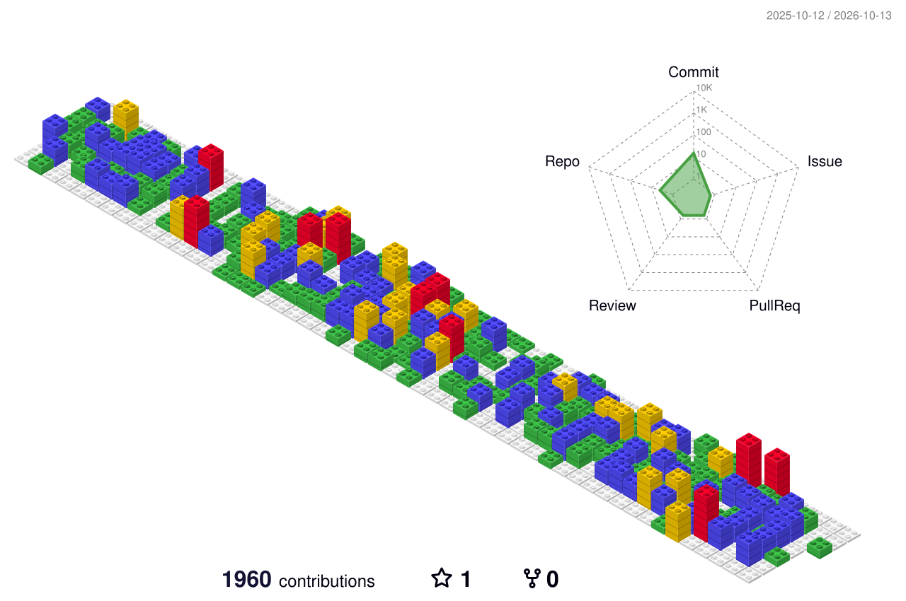

   
 
   
 
  

- 🔭 I’m currently working on React, TypeScript, Next.js

- 🌱 I’m currently learning Next.js, TypeScript, frontend test with jest and vitest.

- 👯 I’m looking to collaborate on anyone who is interested with development or side project

- 🤔 I’m looking for help with Next.js, test code 

- 💬 Ask me about ANYTHING! fill free to talk.

- 📫 How to reach me: knyoung0113@gmail.com

- 😄 Pronouns: she / her

